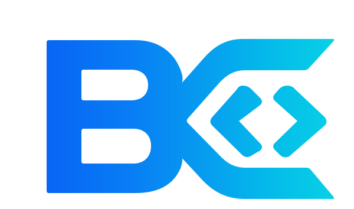

# BlueEdit — Suite Creativa & Caligrafía Digital

<div align="center">



**La suite de edición de documentos, caligrafía manuscrita vectorial y renderizado de alta fidelidad desarrollada por BlueCode.**

[](https://blueedit.web.app/)
[](LICENSE)
[]()

</div>

---

## 🌟 Descripción General

**BlueEdit** es una aplicación web autónoma de alto rendimiento diseñada bajo la estética *Linear Obsidian* de **BlueCode**. Integra un potente lienzo interactivo basado en Fabric.js capaz de cargar, editar y exportar documentos PDF e imágenes, incorporando un **motor propietario de caligrafía manuscrita vectorial** que renderiza texto con glifos orgánicos reales extraídos de caligrafía humana.

---

## 🚀 Características Principales

### ✍️ Motor de Caligrafía Vectorial
- **Glifos orgánicos reales**: Sintetiza trazos a partir de un banco vectorial de glifos (`glyphs-vector.json`).
- **Variabilidad natural**: Selecciona automáticamente variantes distintas de cada carácter para evitar repeticiones idénticas en una misma palabra o párrafo.
- **Tipografías y estilos**: Diversos estilos caligráficos adaptados a documentos oficiales, actas y notas manuscritas.

### 📄 Gestión Integral de Documentos
- **Carga de PDFs & Imágenes**: Rasterización y montaje de documentos multipágina con [PDF.js](https://mozilla.github.io/pdf.js/).
- **Exportación de Alta Fidelidad**: Exporta a PDF con dimensiones exactas en puntos/milímetros mediante [jsPDF](https://github.com/parallax/jsPDF) o genera capturas PNG en resolución HD.
- **Soporte de Firmas y Sellos**: Inserción fluida de firmas digitales y estampados sobre documentos oficiales.

### 🎨 Suite Creativa (Herramientas PhotoCraft)
- **Formas Vectoriales**: Rectángulos, círculos, flechas, líneas, estrellas y polígonos con control de trazo y relleno.
- **Filtros de Procesamiento de Imagen**:
  - *Clean Scan* (limpieza de fondo para documentos escaneados)
  - *Blanco y Negro* / *Sepia* / *Invertir*
  - *Auto-Enhance* y *Pixelate*
- **Estilos de Capa**: Sombras paralelas (*Drop Shadows*), opacidad, transformaciones matriciales y máscaras.
- **Gestión Avanzada de Capas**: Ordenamiento Z-index, duplicación, bloqueo de elementos, visibilidad y agrupación.
- **Historial Completo**: Pila de Deshacer / Rehacer (*Undo/Redo*), zoom libre y paneo con navegación táctil y de ratón.

---

## 🎨 Sistema de Diseño: Linear Obsidian

BlueEdit implementa la identidad visual oficial de **BlueCode**:
- **Fondo Primario**: Obsidiana `#0A0A0C`
- **Superficies**: Pizarra profunda `#121216`
- **Acentos**: Azul Zafiro `#0255F5` y Cian Neón `#00E5FF`
- **Tipografía**: *Inter* para interfaz limpia y *Space Mono* para métricas y coordenadas.

---

## 📁 Estructura del Proyecto

```text
Editor_Actas/
├── assets/
│   ├── data/
│   │   └── glyphs-vector.json   # Banco de glifos vectoriales
│   ├── fonts/                   # Fuentes tipográficas complementarias
│   ├── raw/                     # Vectores y láminas fuente
│   └── scans/                   # Escaneos de referencia caligráfica
├── formatos/                    # Plantillas y formatos base
├── public/
│   ├── index.html               # Versión compilada y desplegable
│   ├── logo_BC.svg              # Isotipo oficial BlueCode
│   ├── favicon.svg              # Favicon vectorial
│   └── vendor/                  # Dependencias empaquetadas offline (PDF.js, Fabric, jsPDF)
├── tools/
│   ├── app.js                   # Lógica central del editor interactivo
│   ├── build.py                 # Script de compilación y empaquetado autónomo
│   ├── svg_glyphs.py            # Generador y optimizador de glifos vectoriales
│   └── extract.py               # Extractor y segmentador de hojas caligráficas
├── editor-actas.html            # Plantilla fuente del editor
├── firebase.json                # Configuración de despliegue multi-sitio en Firebase
└── package.json                 # Dependencias auxiliares de herramientas
```

---

## 🛠️ Compilación y Desarrollo

### Requisitos
- Python 3.9+
- Node.js (opcional para pruebas automatizadas con Puppeteer)

### Compilar el Editor
El editor se ensambla en un único archivo HTML autocontenido para máxima portabilidad y rendimiento:

```bash
# Regenerar glifos y compilar index.html:
python tools/build.py
```

El script incrusta el CSS, el banco vectorial de glifos y la lógica de `tools/app.js` directamente en `public/index.html`.

---

## 🌐 Despliegue en Firebase Hosting

El proyecto está configurado para despliegue directo en **Firebase Hosting** bajo el sitio `blueedit`:

```bash
# Iniciar sesión en Firebase (si no se ha hecho):
firebase login

# Desplegar únicamente el sitio BlueEdit:
firebase deploy --only hosting:blueedit
```

---

## 👥 Equipo de BlueCode

Desarrollado y mantenido por el equipo directivo y técnico de **BlueCode**:
- **Allan Pérez** — *CEO & Gerente General*
- **David** — *Gerente de Producción y Mantenimiento*
- **Nicolás** — *Gerente Ejecutivo & Marketing*

---

© 2026 **BlueCode**. Todos los derechos reservados.
